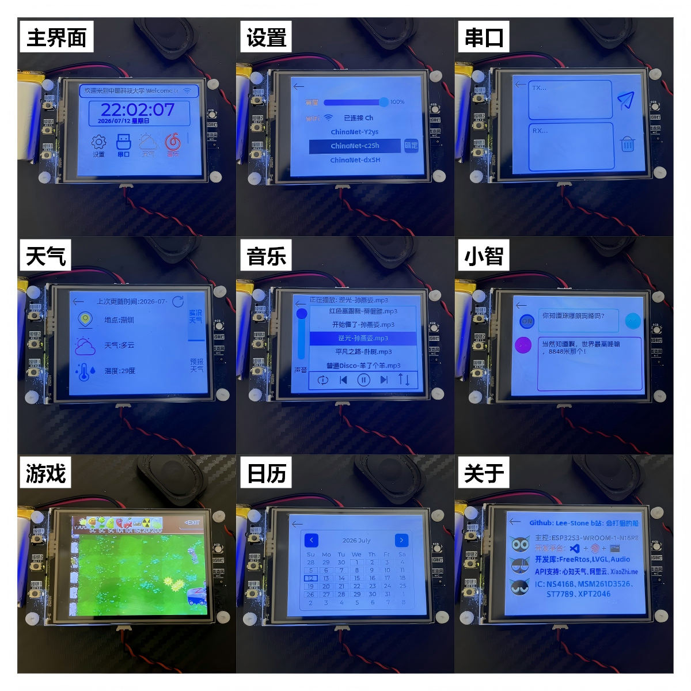
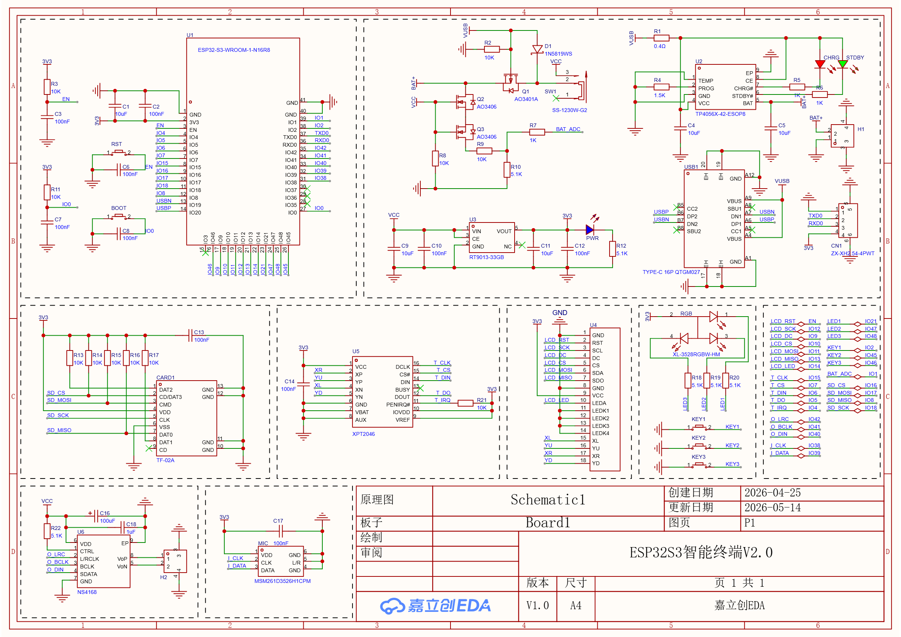

# esp32s3-lvgl-terminal

基于 ESP32-S3 的 LVGL 多功能智能终端，集成 Wi-Fi 和亮度设置、串口终端、时间和天气显示、音乐播放、小智 AI 语音对话、小游戏等功能。

> **🔗 PS**：本工程的 ESP-IDF 版已开源：[esp32s3-lvgl-terminal.idf](https://github.com/Lee-Stone/esp32s3-lvgl-terminal.idf)。

****

**⭐ 欢迎提出 Issues 和 PR，如果这个项目对你有帮助，请给个 Star！**

## 📑 目录

- [📖 项目简介](#-项目简介)
- [📁 项目结构](#-项目结构)
- [🛠️ 硬件配置](#️-硬件配置)
  - [1. 物料清单](#1-物料清单)
  - [2. 引脚映射](#2-引脚映射)
  - [3. 打板焊接](#3-打板焊接)
- [🔧 软件配置](#-软件配置)
  - [1. 安装 VSCode](#1-安装-vscode)
  - [2. 安装插件](#2-安装插件)
  - [3. 编译烧录](#3-编译烧录)
  - [4. 免环境烧录](#4-免环境烧录)
- [⚠️ 注意事项](#️-注意事项)
- [📧 联系方式](#-联系方式)

## 📖 项目简介

这是一个基于 **ESP32-S3** 和 **LVGL** 图形库开发的多功能智能终端项目。通过友好的触摸屏界面，提供丰富的交互功能和便捷的设备管理，项目采用 FreeRTOS 多任务架构，支持高效的并发处理。

**主要功能：**

- ✅ **主界面**：实时显示时间、滚动文字、APP 入口等信息
- ✅ **设置**：支持屏幕亮度调节、Wi-Fi 扫描与连接配置
- ✅ **串口**：实时串口数据收发功能
- ✅ **天气**：显示实况天气和未来三天天气预报，数据来自心知天气 API
- ✅ **音乐**：播放 SD 卡根目录的 MP3 音乐，支持音量调节
- ✅ **小智**：AI 语音对话，使用百度语音识别与 MiniMax 聊天模型
- ✅ **游戏**：集成开源 LVGL 小游戏，包含 2048、植物大战僵尸、消消乐、羊了个羊
- ✅ **日历**：日历信息查看
- ✅ **关于**：设备与项目信息展示
- ✅ **电源管理**：使用 5V USB 或 4.2V 锂电池供电，接上锂电池时插入 USB 可边充边放



**视频演示：**

- [LVGL+Freertos开发基于ESP32S3的智能终端系统，源码已上传_哔哩哔哩_bilibili](https://www.bilibili.com/video/BV1xu4m1c74M/?spm_id_from=333.1387.upload.video_card.click&vd_source=b2115ccf4e995ec04004dc3600b1cecb)
- [LVGL基于ESP32S3的智能终端PLUS_哔哩哔哩_bilibili](https://www.bilibili.com/video/BV1eXSuBkEo8/?spm_id_from=333.1387.upload.video_card.click&vd_source=b2115ccf4e995ec04004dc3600b1cecb)

**项目教程：**

- [LVGL+FreeRTOS开发基于ESP32S3的智能终端项目实战教程(Arduino/IDF)_哔哩哔哩_bilibili](https://www.bilibili.com/video/BV1aP4F69EDk?spm_id_from=333.788.videopod.sections&vd_source=b2115ccf4e995ec04004dc3600b1cecb)

**开发板链接：**

- [ESP32S3智能终端开发板](https://c.tb.cn/h.jgUCDzlfXCHbVxS?tk=A2tb6aqveNl)（有需要可以购买）

## 📁 项目结构

```
esp32s3-lvgl-terminal/
├── src/                        # 源代码目录
│   ├── main.cpp                # 主程序入口，初始化显示、触摸与任务
│   ├── config.cpp/.h           # 配置管理模块
│   ├── data.cpp/.h             # 数据处理模块
│   ├── task.cpp/.h             # FreeRTOS 任务管理
│   ├── wifiuser.cpp/.h         # Wi-Fi 扫描、连接与状态管理
│   ├── music.cpp/.h            # SD 卡 MP3 音乐播放控制
│   ├── sduser.cpp/.h           # SD 卡初始化与文件操作
│   ├── xiaozhi.cpp/.h          # AI 语音对话与识别模块
│   └── ui/                     # LVGL UI 组件
│       ├── ui.h                # UI 头文件
│       └── src/                # UI 源代码
│           ├── screens/        # 各页面界面
│           ├── components/     # UI 组件
│           ├── images/         # 图片资源
│           ├── fonts/          # 字体资源
│           └── ui.cpp          # UI 主文件
├── SquareLine_Project/         # SquareLine Studio 项目文件
│   ├── SquareLine_Project.spj  # 项目配置文件
│   ├── assets/                 # 设计资源
│   ├── backup/                 # 备份文件
│   └── cache/                  # 缓存文件
├── hardware/                   # 硬件设计文件
│   ├── SCH_Schematic_*.pdf     # 原理图 PDF
│   ├── Gerber_PCB_*.zip        # PCB Gerber 文件
│   └── BOM_PCB_*.xlsx          # BOM 采购清单
├── scripts/                    # 免环境烧录工具，包含 flash.bat 与 esptool
├── images/                     # README 图片资源
├── include/                    # 头文件目录
├── lib/                        # 外部库目录
├── platformio.ini              # PlatformIO 配置文件
├── default_16MB.csv            # 分区表配置
├── README.md
└── LICENSE
```

## 🛠️ 硬件配置

### 1. 物料清单

- **主控芯片**：ESP32-S3 N16R8，16MB Flash + 8MB PSRAM
- **显示屏**：ST7789 2.4 寸 SPI TFT，320×240
- **触摸屏**：XPT2046 SPI 电阻触摸
- **音频输出**：NS4168 I2S DAC 功放模块
- **麦克风**：MSM261D3526H1CPM PDM 数字麦克风
- **存储卡**：Micro SD 卡
- **状态灯**：XL-3528RGBW RGB LED
- **电源管理**：TP4056X 单节锂电池充电、RT9013 LDO 稳压、AO3401A 与 AO3406 电源切换
- **供电**：5V USB 供电或 4.2V 锂电池供电

### 2. 引脚映射

| 功能模块 | 引脚定义 |
|---------|:--------|
| **SPI TFT 显示屏** | SCK=12, MOSI=11, MISO=13, CS=10, DC=9, BLK=14, RST=NC |
| **SPI 触摸屏** | CLK=15, CS=7, DIN=6, DO=5, IRQ=4 |
| **I2S 音频输出** | BCLK=41, LRC=42, DIN=40 |
| **PDM 麦克风** | CLK=38, DATA=39 |
| **SPI SD 卡** | SCK=18, MOSI=17, MISO=8, CS=16 |
| **按键** | KEY1=2, KEY2=45, KEY3=46 |
| **RGB LED** | R=21, G=47, B=48 |
| **ADC 电池检测** | ADC1_CH0=1 |

### 3. 硬件实物


### 4. 硬件原理图



### 5. 打板焊接

**PCB 打板：**

- 板子尺寸 74x43.3mm，可在 **嘉立创** 领取 1 至 4 层专用券免费打板
- 上传 `hardware/` 目录中的 Gerber 文件
- 选择参数：层数 2 层、板子数量 5、板厚 1.6mm

**元器件采购与焊接：**

- 参考 `hardware/` 目录中的 BOM 表
- BOM 表包含元器件型号、数量和购买链接
- 板上元器件都标注了位号，根据 BOM 表焊接
- BOM 表中未标注的位号不需要焊接

## 🔧 软件配置

### 1. 安装 VSCode

**下载**：访问 [VSCode 官网](https://code.visualstudio.com/)，点击 "Download for Windows" 下载安装包。

**安装**：运行下载的安装程序，按照提示完成安装。建议勾选 "Add to PATH" 选项。

### 2. 安装插件

**中文语言包**：

*   点击左侧扩展图标，搜索 `Chinese`。
*   选择 **Chinese (Simplified) (简体中文) Language Pack**，点击 **Install**。
*   安装完成后重启 VSCode 即可生效。

**C/C++ 扩展**：

*   点击左侧扩展图标，搜索 `C/C++`。
*   选择由 **Microsoft** 发布的插件，点击 **Install**。
*   该插件提供代码高亮、智能提示等功能，是开发 C/C++ 项目的基础。

**Serial Monitor 扩展**：

*   点击左侧扩展图标，搜索 `Serial Monitor`。
*   选择由 **Microsoft** 发布的插件，点击 **Install**。
*   该插件提供串口监视器，可以实时查看开发板的输出信息。

**PlatformIO 扩展**：

- 点击左侧扩展图标，搜索 `PlatformIO`。
- 选择由 **PlatformIO** 发布的插件，点击 **Install**。
- VS Code 右下角会提示 "Installing PlatformIO Core..."，等待安装完成。
- 安装完成后通常会提示重启 VS Code，点击 "Reload Now" 或手动重启。

### 3. 编译烧录

**克隆项目**：

  ```powershell
  git clone https://github.com/Lee-Stone/esp32s3-lvgl-terminal.git
  ```

**打开项目**：

*   在 VS Code 中，点击菜单栏 `File` -> `Open Folder...`。
*   选择克隆的 `esp32s3-lvgl-terminal` 目录。

**等待初始化**：

*   首次打开 PlatformIO 项目时，它会自动下载项目所需的开发框架和依赖库，等待下载完成。

*   若下载仍然很慢，则打开本地 `C:\Users\用户名\.platformio\penv\pip.conf`，替换为以下内容，保存后重启 VS Code：

  ```
  [global]
  user = no
  index-url = https://mirrors.aliyun.com/pypi/simple/
  
  [install]
  trusted-host = mirrors.aliyun.com
  ```

**配置说明**：

- 百度语音 API：在 `.pio\libdeps\esp32-s3-devkitc-1\baidu-xiaozhi\xiaozhi_ai.h` 中填入 `BAIDU_APP_ID`、`BAIDU_APP_KEY` 和 `BAIDU_SECRET_KEY`，并将 `I2S_PDM` 置为1。

  [百度语音 API申请](https://blog.csdn.net/vor234/article/details/136975580)

- MiniMax API：在 `.pio\libdeps\esp32-s3-devkitc-1\baidu-xiaozhi\xiaozhi_minimax.h` 中填入 `MiniMaxKey`。

  [MiniMax API申请](https://vor2345.blog.csdn.net/article/details/136768206)

- 心知天气 API：在 `src\data.cpp` 中填入 `Weather_Key`。

  [心知天气 API申请](https://www.seniverse.com/)

**编译项目**：

*   点击 VS Code 底部状态栏左侧的 **对号图标 (Build)** `✓`。
*   或者使用快捷键 `Ctrl+Alt+B`。
*   如果终端输出 `SUCCESS`，说明环境配置无误且代码编译成功。

**烧录程序**：

*   点击底部状态栏的 **右箭头图标 (Upload)** `→`。
*   开发板支持 USB 自动下载，PlatformIO 会自动寻找串口并烧录程序。
*   如果无法自动进入下载模式，按住 BOOT 按键，按下 RST 按键松开，再松开 BOOT 按键后重新烧录。

### 4. 免环境烧录

**下载烧录工具**：[flash.zip](https://github.com/Lee-Stone/esp32s3-lvgl-terminal/releases/latest/download/flash.zip)

**烧录程序**：

- 解压**烧录工具**，双击文件夹下的 **flash.bat** 文件，若提示有风险，右击以**管理员身份运行**。

  

- 选择开发板的串口序号，输入 **y** 确定后开始烧录。

  

  

- 烧录完成之后提示 **Flash Successful**。

  

**提示**：烧录工具中包含工程编译出来的 **bin** 文件。

## ⚠️ 注意事项

- **首次使用需配置 API 密钥**：百度语音、MiniMax AI 和心知天气的 API 需要自行申请并填入相应配置文件中，否则相关功能无法使用。

- **SquareLine Studio 工程**：需要下载 SquareLine Studio 1.5.0 打开。

- **烧录模式**：开发板支持 USB 自动下载，直接烧录即可。无法自动下载时，按住 BOOT 按键，按下 RST 按键松开，再松开 BOOT 按键后重试。

- **SD 卡格式要求**：SD 卡推荐使用闪迪，大小无要求，需格式化为 FAT32 文件系统，MP3 文件需放置在根目录才能被识别。

- **网络环境**：首次编译需要下载大量依赖库和工具链，建议开启魔法以加快下载速度。如遇下载慢，可配置国内 pip 源。

- **电源供电**：建议使用 5V/2A 以上的电源适配器或质量可靠的 USB 数据线，避免因供电不足导致系统不稳定。

- **串口波特率**：串口通信波特率默认为 115200，使用串口监视器时需保持一致。

## 📧 联系方式

- 🐧：2103539430
- 🛰：Ubuntu_Noble
